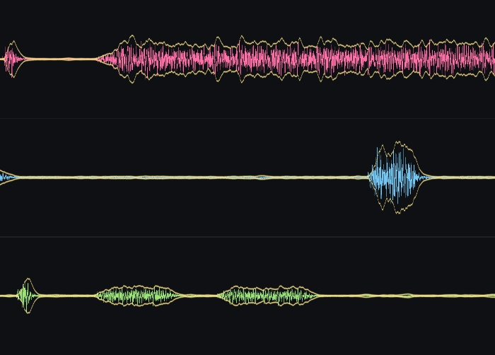

# EMG Simulator

A **surface EMG simulator** that behaves like a real sensor and sends its signal over **OSC**,
so Max/MSP, Pd, SuperCollider, TouchDesigner or anything else can use it in place of hardware.
For teaching without boards, testing patches, and building mappings before the sensors are there.

<p align="center"></p>

Two simulators, the same OSC addresses (`/emgsim/...`, `/bio`, `/adc`):

| | what | for |
|---|---|---|
| **Python simulator** (`run_emgsim.py`) | biophysical: motor units, action potentials, fatigue, realistic noise; 7 OSC streams; everything adjustable; window in the web browser | research, teaching the physiology, testing analysis and machine learning |
| **TouchDesigner simulator** (`touchdesigner/`) | simple, built from TouchDesigner operators only, one panel | quick tests inside TouchDesigner, teaching the signal chain node by node |

By default a **simulated player** contracts at random, like a real person: rests, normal
squeezes, accents, strong bursts, long holds, ramps, quick flurries. Every start is a new run.

---

## Quick start

### A. Python simulator (macOS or Windows)

1. **Download**: on this page, green **Code** button &rarr; **Download ZIP**, and unzip it
   (or `git clone https://github.com/Liquidam/emg-simulator`).
2. **Python 3.9 or newer** from [python.org](https://www.python.org/downloads/).
   Windows: tick **"Add python.exe to PATH"** in the installer.
3. **NumPy**, once. Open a terminal (Mac: Terminal; Windows: Command Prompt) and type:
   ```
   python -m pip install numpy
   ```
   (Mac: `python3 -m pip install numpy`. Windows, if `python` is not found: `py -m pip install numpy`.)
4. **Start** it from the unzipped folder:
   ```
   cd path/to/emg-simulator
   python run_emgsim.py
   ```
   (Mac: `python3 run_emgsim.py`; Windows: `py run_emgsim.py`, or double-click `run_emgsim.py`.)
5. Your **web browser opens** with the simulator and a short **How to use** popup
   (open it again with **? Help**). The page is served by the simulator itself, on this
   computer only. Stop with **Quit** on the page, or Ctrl+C in the terminal.

> Windows may ask whether Python may use the network: allow it on private networks, so the
> OSC messages can reach Max / Pd / TouchDesigner.

### B. TouchDesigner simulator

Open `touchdesigner/EMG_SIM.toe` (TouchDesigner 2025 or newer; the free licence is fine).
The panel and a **How to use** popup open by themselves. To use it in your own project,
drag `touchdesigner/EMG_SIM.tox` into it. Details: [`touchdesigner/README.md`](touchdesigner/README.md).

### C. Receive it in Max/MSP

Both simulators send to `127.0.0.1:9100` by default:

```
[udpreceive 9100]
|
[route /emgsim/env /emgsim/raw]
|                 |
[unpack f f f f]  [unpack f f f f]    <- envelope 0..1 / raw EMG in mV, one value per channel
```

Play the Python simulator from Max: send `/emgsim/drive 0.7` (or `/emgsim/mode pulses`, ...)
with `[udpsend 127.0.0.1 9201]`. All messages: section 4.

---

## 1. Install and start (more detail)

1. Install **Python 3.9 or newer** from [python.org](https://www.python.org/downloads/).
   On Windows, tick **"Add python.exe to PATH"** in the installer.
2. Install NumPy once (Terminal on Mac, Command Prompt on Windows):
   ```
   python -m pip install numpy
   ```
   (On a Mac the command may be `python3`.)
3. Start the simulator from this folder:
   ```
   python run_emgsim.py
   ```
   On Windows you can also double-click `run_emgsim.py`.
   **The window opens in your web browser** (http://127.0.0.1:8765). It is served by the
   simulator itself, on this computer only. Stop it with **Quit** on the page or Ctrl+C.
   (The old desktop window is still there with `python run_emgsim.py --tk`; it needs a
   Python with Tk 8.6, so it shows a blank window with Apple's built-in Python.)

Without a window (for a server, a Raspberry Pi, or scripts):
```
python -m emgsim --headless --preset max_msp_full
python -m emgsim --headless --preset emg6_esp32 --seconds 60 --record take1.csv
python -m emgsim --list-presets
```

## 2. The window

| tab | what you set |
|---|---|
| **PERFORM** | the effort. The default scenario is **performer**: a simulated player who contracts at random like a real person (rests, normal squeezes, accents, strong bursts, long holds, ramps, flurries, shaky contractions), set by **activity** and **intensity**. Other scenarios: manual, pulses, ramp, hold, tremor, improv, staccato, MVC test. The **space bar** and the effort slider always add on top. Channels can follow one player (linked) or each have their own. |
| **MUSCLE** | number of channels (1-8), motor units, amplitude, MUAP width, firing rates, fatigue, crosstalk |
| **NOISE** | electrode contact quality, baseline noise, power-line hum (50/60 Hz), baseline wander, movement artifacts, electrode pops, ECG |
| **DEVICE** | sample rate, amplifier filters (20-450 Hz by default), ADC bits, offset, gain, converter noise |
| **OSC OUT** | destination, and every output stream (on/off, address, rate, units, port) |

The scope shows the last 4 seconds per channel (dashed line = effort), with live numbers:
recruited motor units, mean firing rate, fatigue, RMS and median frequency.
**Record** saves `.csv` (time, effort, signal in mV, ADC counts) or `.wav`.
**Save settings / Load settings** store everything in a `.json` file.

## 3. OSC output

Default destination: `127.0.0.1:9100`. Every stream can be switched on or off and can have its own port.

| stream | address and arguments | default rate |
|---|---|---|
| **raw** | `/emgsim/raw ch1 ch2 …` one message per sample. Units `mV`, `uV`, `counts` or `norm` (-1..1). Decimation `average` (anti-aliased) or `point` (like a microcontroller, aliases) | 1000 Hz |
| **rawblock** | `/emgsim/rawblock/N s1 s2 …` one message per channel per engine block, all samples at the full rate (audio-rate use, e.g. into a Max buffer) | every 10 ms |
| **env** | `/emgsim/env e1 e2 …` RMS envelope; normalised so that 1 = maximal effort | 100 Hz |
| **features** | `/emgsim/features/N rms mav wl zcr tkeo mnf mdf` per channel | 20 Hz |
| **truth** | `/emgsim/truth/drive`, `/force`, `/fatigue`, `/active`, `/rate` (one value per channel): what the simulated body really did. Ground truth for machine learning and for checking an analysis | 50 Hz |
| **bio** | `/bio seq t_us emg_raw ax ay az gx gy gz`: the exact format of our ESP32 sensor (EMG6). EMG in 12-bit ADC counts around 2160 (preset `emg6_esp32`: 1400 counts per mV, matched to live sensor data), IMU in g and deg/s | 200 Hz |
| **adc** | `/adc a1 a2 a3 a4`: Federico Visi's **wearpi-py** format, four envelopes 0..1 with adaptive min/max and a moving average | 100 Hz |

## 4. Control it over OSC

Send to port **9201** (changeable):

| message | does |
|---|---|
| `/emgsim/drive 0.7` | effort of all channels (0..1) |
| `/emgsim/drive 2 0.7` | effort of channel 2 |
| `/emgsim/mode pulses` / `/emgsim/mode 2 hold` | scenario of channel 1 (or all, if linked) / of channel 2 |
| `/emgsim/set noise.contact 0.3` | any setting, by its path in the settings file |
| `/emgsim/preset classroom_noisy` | load a preset |
| `/emgsim/fatigue/reset` | rested muscles |
| `/emgsim/pause 1` / `0` | pause / resume |

So a Max patch can *play* the simulator (a slider into `/emgsim/drive`) and *listen* to it at the same time.

## 5. Presets

| preset | for |
|---|---|
| `clean_lab` | gel electrodes, quiet room: the textbook signal |
| `classroom_noisy` | dry electrodes, hum, movement: what a class really sees |
| `loose_electrode` | one electrode losing contact: hum, pops, big artifacts |
| `fatigue_demo` | a long 60 % hold: median frequency falls, amplitude rises |
| `emg6_esp32` | drop-in replacement for our ESP32 sensor, `/bio` to EMG6 on port 9100 |
| `wearpi_4ch` | drop-in replacement for the WearPi, `/adc` to port 57120 |
| `max_msp_full` | raw + envelope + features + truth to port 7400 |

## 6. The model

The signal is built the way it is built in the body, one layer after the other.

1. **Effort** (0..1) from the performer (random, human-like gestures: `emgsim/performer.py`),
   a scenario, the slider, the space bar or OSC, with a human-like rise and fall.
2. **Motor-unit pool** per muscle, after Fuglevand, Winter & Patla (1993):
   120 units, recruitment thresholds spread exponentially over a range of 30 (small units first,
   Henneman's size principle); firing rate rises linearly from 8 Hz at threshold to a peak of
   35 Hz (first unit) down to 25 Hz (last unit); irregular discharge (interval CV 0.2);
   a shared slow fluctuation of the excitation (common drive, De Luca).
3. **Motor-unit action potentials** at the skin: Hermite-Rodriguez shapes (bi- and triphasic);
   wider and smaller for deeper units (tissue is a low-pass filter); width scales with
   1 / conduction velocity (3-5.5 m/s, larger units faster).
4. **Fatigue**: sustained effort lowers conduction velocity (up to 45 %), so the spectrum
   compresses to lower frequencies while amplitude rises; to keep the effort the excitation
   increases. Rest recovers.
5. **Crosstalk**: each electrode also picks up its neighbours, low-pass filtered.
6. **Noise**: baseline (amplifier + electrode), power-line hum with harmonics, baseline wander,
   movement artifacts (random and at movement onsets, mostly below 20 Hz), electrode pops, ECG.
   Electrode **contact** scales hum, artifacts and pops together.
7. **Device**: 4th-order 20 Hz high-pass and 450 Hz low-pass (SENIAM; De Luca et al. 2010),
   optional notch, ADC with offset, gain, bits and converter noise.

## 7. Simulation and randomness

This is a simulation in the scientific sense: the signal is computed from a model of how it
arises in the body (motor units, their firing, their action potentials, tissue, electrode, amplifier),
not played back from recordings and not drawn as a picture.

Randomness lives where it lives in reality:
* **the player** (`performer.py`): when a gesture starts, which kind, how strong, how long;
* **the motor units**: each discharge interval varies (CV 0.2), each unit's depth, shape and
  conduction velocity are drawn at start, and a shared slow fluctuation (common drive);
* **the world**: baseline noise, hum level and phase drift, artifacts and pops at random times.

`seed` (DEVICE tab, or the settings file): **0 = a different run every start** (the default).
Any other number replays exactly the same run, sample for sample: useful for experiments and
for comparing two analysis methods on identical data. The validation uses seed 1.

## 8. Validation

`python validation/validate.py` checks the output against known properties of real surface EMG
and writes `validation/REPORT.txt`. Current result: **12 / 12 checks in range**.

| property | measured | expected |
|---|---|---|
| amplitude vs effort | rises monotonically, compresses near maximum (top slope 0.35 of bottom slope) | monotonic, compressive |
| mean / median frequency at 50 % | 105 / 96 Hz | 60-160 / 50-150 Hz |
| units recruited at 10 % / 90 % | 47 % / all 120 | early recruitment of many small units, all by ~70-90 % |
| 60 s hold at 60 %: median frequency | −11.5 % | −8 to −40 % |
| 60 s hold at 60 %: RMS | +30 % | rises |
| rest noise, good contact | 2.7 µV RMS | 1-15 µV |
| loose electrode: power in 45-55 Hz | 93 % | dominant |
| crosstalk to a relaxed neighbour | 11 % of RMS | 5-35 % |

## 9. Honest limits

* MUAPs are analytic shapes, not a finite-element volume conductor; there is one bipolar
  electrode per muscle (no high-density grid). Good for the statistics of the signal, not for
  decomposition research.
* The force output is an estimate (twitch sizes and a saturating rate-force curve).
* The IMU in the `/bio` stream is simple: the arm lifts with effort, plus noise.
* The EAVI board's own OSC format is not known to us yet, so there is no EAVI preset. Any
  address and rate can be set by hand on the OSC OUT tab.
* Timing: messages leave every engine block (10 ms by default); a MUAP peaks 15 ms after its
  spike, so the EMG follows the `truth/drive` stream by about 15 ms.

## 10. References

* Fuglevand AJ, Winter DA, Patla AE (1993). Models of recruitment and rate coding organization in
  motor-unit pools. *J Neurophysiol* 70(6):2470-2488.
* De Luca CJ, Gilmore LD, Kuznetsov M, Roy SH (2010). Filtering the surface EMG signal: movement
  artifact and baseline noise contamination. *J Biomech* 43(8):1573-1579.
* Petersen E, Rostalski P (2019). A comprehensive mathematical model of motor unit pool organization,
  surface electromyography, and force generation. *Front Physiol* 10:176.
* Lowery MM, Vaughan CL, Nolan PJ, O'Malley MJ (2000). Spectral compression of the
  electromyographic signal due to decreasing muscle fiber conduction velocity. *IEEE TRE* 8(3).
* Hermens HJ et al. (1992) and SENIAM recommendations on surface EMG.
* Visi FG, Tanaka A (2021). Interactive Machine Learning of Musical Gesture. In Miranda ER (ed.),
  *Handbook of Artificial Intelligence for Music*, Springer. (features: RMS, MAV, ZCR, TKEO)
* Visi FG, *wearpi-py*, https://github.com/wearablecomputing/wearpi-py (the `/adc` format).
